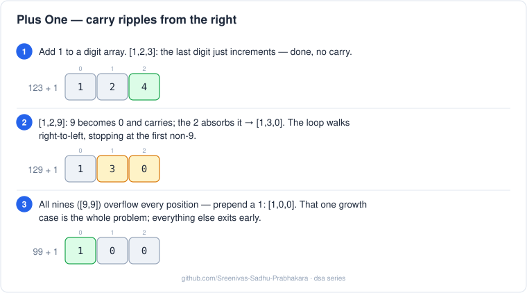

# Plus One

> NeetCode 150 · Math & Geometry — schoolbook carry from the last digit; the only interesting input is all nines, which grows the array. Go, stdlib only, tested.

## Problem

Increment a non-negative integer stored as a digit slice (most significant first) — the number may far exceed any machine integer.

## Approach

Carry propagation in its simplest form: walking from the least significant digit, the first non-9 absorbs the +1 and the function returns immediately — for random inputs that's O(1) expected work. Nines roll to zero and pass the carry on. If the walk falls off the left edge, every digit was 9 and the result needs one more digit: prepend a 1 to the (now all-zero) slice. Working on a copy keeps the caller's slice intact — pinned by a test, since in-place "helpful" mutation is the usual library-design sin here.

**Complexity:** O(n) worst case, O(1) expected; O(n) for the copy.

## Visual walkthrough

Read the picture top to bottom — each numbered frame is one moment of the algorithm
running on this repo's test example.

## Run

    go test ./...   # verify
    go run .        # demo

---

Part of a 275-repo DSA series in Go — Striver's SDE Sheet (dsa-001–191) plus the NeetCode 150 / Blind 75 additions (dsa-192–275), stdlib only, every solution tested. Browse: [`dsa-*` repos](https://github.com/Sreenivas-Sadhu-Prabhakara?tab=repositories&q=dsa-&type=source).
